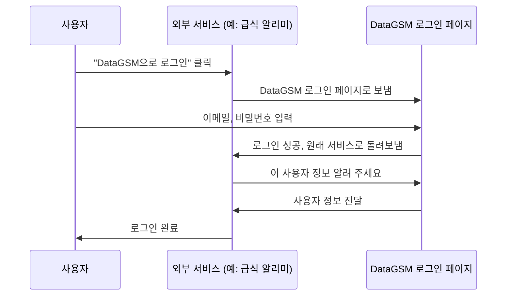

# 2편. 로그인 (OAuth)

> 교내 서비스들이 로그인 기능을 직접 만들지 않고, **"DataGSM으로 로그인"** 버튼 하나로 학교 구성원을 확인할 수 있게 해 주는 기능이에요.

## 왜 필요한가요?

교내 서비스를 만들 때마다 회원가입과 로그인을 새로 만든다고 생각해 보세요.

- 서비스를 만드는 사람은 매번 회원가입, 비밀번호 찾기, 학생 확인 기능을 처음부터 만들어야 해요.
- 학생은 서비스마다 아이디와 비밀번호를 따로 만들어야 하고, 학번이나 반 같은 정보도 매번 다시 입력해야 해요.
- 서비스가 그 사람이 진짜 우리 학교 학생인지 확인하기도 어려워요.

예전에는 GAuth라는 교내 인증 서비스가 이 역할을 했는데, 2024년에 운영이 끝났어요. DataGSM은 그 빈자리를 채우려고, 이미 가지고 있는 학생 데이터를 바탕으로 로그인 기능을 만들었어요.

"구글로 로그인"이나 "카카오로 로그인"을 떠올리면 쉬워요. DataGSM 로그인은 그 **학교 버전**이에요.

## 누가 쓰나요?

| 누가 | 어디서 | 무엇을 |
|---|---|---|
| 학생, 선생님 | 로그인 페이지 | 외부 서비스에 DataGSM 계정으로 로그인 |
| 학생, 선생님 | 개발자 콘솔의 내 정보 화면 | 로그인된 기기(세션) 확인, 강제 로그아웃 |
| 외부 개발자 | 자기 서비스 | "DataGSM으로 로그인" 버튼을 붙이고, 로그인한 사용자 정보를 받아 감 |

DataGSM이 직접 운영하는 개발자 콘솔, 관리자 페이지, 프로젝트 사이트도 전부 이 로그인 기능으로 로그인해요. DataGSM 자신도 이 기능의 사용자인 셈이에요.

## 기능 살펴보기

### 로그인 흐름

사용자 입장에서 로그인은 이렇게 진행돼요.

여기서 중요한 점은 **외부 서비스는 사용자의 비밀번호를 전혀 모른다**는 거예요. 비밀번호는 DataGSM 로그인 페이지에만 입력하고, 외부 서비스는 "이 사람이 로그인에 성공했다"는 증표(토큰)만 받아요.

로그인 페이지에는 어떤 서비스가 로그인을 요청했는지와 그 서비스가 원하는 정보가 함께 보여요. 로그인 페이지는 **10분** 동안만 유효하고, 화면에 남은 시간이 표시돼요. 시간이 지나면 원래 서비스로 돌아가서 다시 시작해야 해요.

### 동의 화면

외부 서비스가 내 정보를 가져가려면 내가 허락해야 해요. 이걸 **동의**라고 해요.

동의 화면에는 "급식 알리미가 다음 권한을 요청합니다"처럼 서비스 이름과 요청한 권한 목록이 나오고, 사용자가 **승인**하거나 **거부**할 수 있어요.

- **승인**: 서비스로 돌아가면서 로그인이 끝나요. DataGSM은 "이 사람은 이 서비스에 이 권한을 허락했다"는 기록을 남겨요.
- **거부**: 서비스에 "사용자가 거부했다"는 결과를 돌려줘요.

한 번 동의한 서비스는 다음에 로그인할 때 동의 화면을 다시 띄우지 않아요. 다만 서비스가 **새로운 권한을 추가로 요청하면** 그 권한에 대해 다시 동의를 받아요.

로그인 페이지에서 비밀번호를 입력해 로그인하면, 그 화면에 보였던 권한에 동의한 것으로 처리해요. 별도의 동의 화면은 이미 로그인된 상태에서 새 서비스를 쓸 때 나와요.

### 통합 로그인 (SSO)

한 번 DataGSM에 로그인하면, 같은 브라우저에서 다른 교내 서비스를 쓸 때 **비밀번호를 다시 입력하지 않아도** 돼요. 이걸 SSO(Single Sign-On, 통합 로그인)라고 해요.

예를 들어 프로젝트 사이트에 로그인한 다음 급식 알리미에서 "DataGSM으로 로그인"을 누르면 이렇게 돼요.

- 급식 알리미에 이미 동의한 적이 있으면: 아무것도 입력하지 않고 바로 로그인돼요.
- 처음 쓰는 서비스라면: 비밀번호 없이 동의 화면만 나와요.

이 통합 로그인 상태는 **8시간** 동안 유지돼요.

### 로그인 세션 관리

개발자 콘솔의 **내 정보** 화면에서 지금 DataGSM에 로그인되어 있는 기기(세션) 목록을 볼 수 있어요. 각 세션이 언제 만들어졌는지도 나와요.

모르는 기기가 있으면 그 세션을 **종료**할 수 있어요. 종료하면 그 기기에서는 새 서비스에 로그인할 때 비밀번호를 다시 입력해야 해요. 다만 그 기기에서 **이미 로그인해 둔 서비스**는 바로 로그아웃되지 않을 수 있어요. 화면에도 이 점을 경고로 보여 줘요.

### 정보 수정 요구

학교 데이터는 매년 바뀌어요. 학년이 올라가면 학번이 바뀌고, 기숙사 호실과 동아리도 바뀌죠. 그런데 학생이 직접 고치지 않으면 DataGSM에는 작년 정보가 그대로 남아요.

그래서 관리자는 학생들에게 **정보 수정 요청**을 보낼 수 있어요. 요청할 수 있는 항목은 다음 네 가지예요.

- 학번 (학년, 반, 번호)
- 기숙사 호실
- 전공 동아리
- 자율 동아리

요청을 받은 학생은 다음에 로그인할 때 **"관리자가 정보 변경을 요청했습니다"** 라는 화면을 보게 되고, 요청된 항목을 입력해야 로그인이 끝나요. 바뀐 게 없으면 기존 정보를 그대로 입력하면 돼요.

이렇게 하면 학생이 따로 시간을 내지 않아도, 자주 쓰는 서비스에 로그인하는 김에 정보를 최신으로 맞출 수 있어요. 관리자가 요청을 보내는 방법은 [5편](./05.%20학생.md)에서 다뤄요.

### 로그인이 막히는 경우

| 상황 | 결과 |
|---|---|
| 이메일이나 비밀번호가 틀림 | 로그인 실패 |
| 10분 동안 비밀번호를 10번 넘게 틀림 | 잠시 로그인 시도가 막힘 |
| 선생님 계정이 아직 승인되지 않음 | "아직 승인되지 않은 계정입니다" 안내 |
| 정보 수정 요청이 남아 있음 | 정보 수정 화면으로 이동 |
| 한 서비스에서 1분에 300번 넘게 요청함 | 그 서비스의 요청이 잠시 막힘 |

로그인 시도 횟수는 비밀번호가 틀린 시도만 세요. 정상적으로 로그인한 시도는 횟수에서 빼 줘요.

### 사용자 정보 제공

로그인이 끝나면 외부 서비스는 DataGSM에 "이 사용자가 누구인지" 물어볼 수 있어요. 이때 돌려주는 정보는 **사용자가 동의한 권한만큼만**이에요.

| 권한 | 받을 수 있는 정보 |
|---|---|
| 계정 정보 조회 | 이메일, 권한 등급, 학생인지 선생님인지 |
| 학생 정보 조회 | 학번, 이름, 학과, 기숙사 호실 등 학생 정보, 선생님이라면 선생님 정보 |
| 동아리 정보 조회 | 소속 동아리 |
| 프로젝트 정보 조회 | 참여한 프로젝트 |

예를 들어 동아리 권한을 받지 않은 서비스에는 학생 정보 안에 있는 동아리 정보까지 가려서 보내요.

### 외부 개발자를 위한 정보

외부 개발자가 로그인을 붙일 때 알아 두면 좋은 내용이에요. 자세한 방법은 기술 문서에 있어요.

- DataGSM 로그인은 **OAuth 2.0**이라는 업계 표준 방식을 따라요. 그래서 다른 OAuth 로그인을 붙여 본 경험이 그대로 통해요.
- 보안을 높이는 **PKCE** 방식과 기존의 client secret 방식을 모두 지원해요.
- 로그인에 성공하면 **Access Token**(1시간)과 **Refresh Token**(30일)을 받아요. Access Token이 만료되면 Refresh Token으로 새로 받아요.
- **OpenID Connect(OIDC)** 도 지원해서, 표준 OIDC 라이브러리로도 연동할 수 있어요.
- 사람이 로그인하지 않고 서버끼리 통신할 때 쓰는 방식(Client Credentials)도 지원해요.

## 다른 도메인과의 관계

- **계정 (1편)**: 로그인하는 사람은 모두 DataGSM 계정이 있어야 해요.
- **OAuth 클라이언트와 애플리케이션 (4편)**: 외부 서비스가 DataGSM 로그인을 쓰려면 먼저 OAuth 클라이언트로 등록해야 해요. 동의 화면에 나오는 권한 목록도 여기서 정해요.
- **학생 (5편)**: 정보 수정 요구는 관리자가 학생 관리 화면에서 보내요.
- **이벤트 (9편)**: 로그인할 때 학생 정보를 수정하면, 그 변경도 이벤트로 외부 서비스에 알려요.

## 기억할 용어

| 용어 | 뜻 |
|---|---|
| OAuth | 비밀번호를 공유하지 않고 다른 서비스에 로그인 권한을 주는 표준 방식 |
| 동의 | 외부 서비스에 내 정보 제공을 허락하는 것 |
| SSO (통합 로그인) | 한 번 로그인하면 다른 서비스에서 다시 로그인하지 않아도 되는 것 |
| 세션 | 로그인되어 있는 상태. 기기(브라우저)마다 하나씩 생겨요. |
| 토큰 | 로그인에 성공했다는 증표. 외부 서비스는 비밀번호 대신 이걸 받아요. |
| 정보 수정 요구 | 관리자가 요청한 학생 정보를 로그인할 때 입력하게 하는 기능 |

## 한 번 더 정리

- DataGSM 로그인은 교내 서비스용 "구글로 로그인"이에요. 외부 서비스는 비밀번호를 모르고 토큰만 받아요.
- 외부 서비스는 사용자가 동의한 정보만 받을 수 있어요.
- 한 번 로그인하면 8시간 동안 다른 서비스에서 비밀번호 없이 로그인할 수 있어요 (SSO).
- 내 정보 화면에서 로그인된 기기를 확인하고 종료할 수 있어요.
- 관리자가 정보 수정을 요청하면, 학생은 다음 로그인 때 정보를 고쳐야 로그인할 수 있어요.
